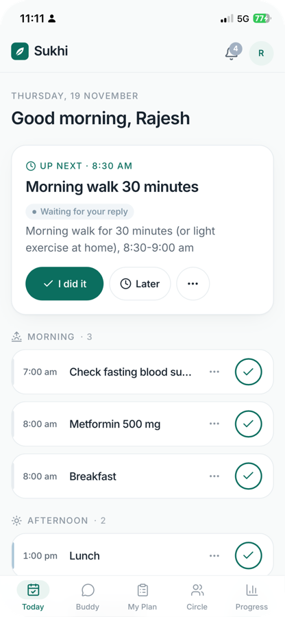
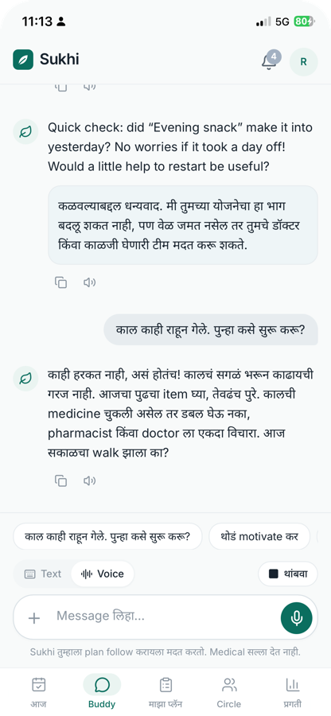
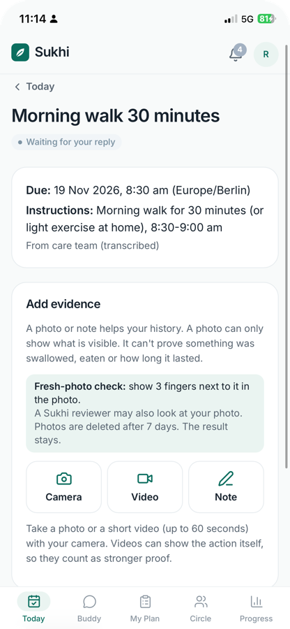
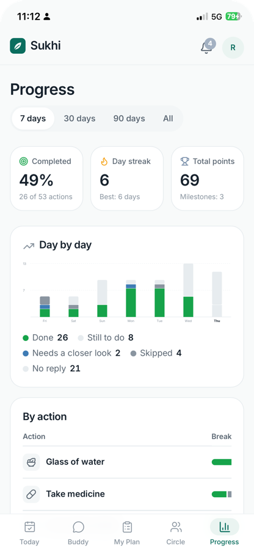
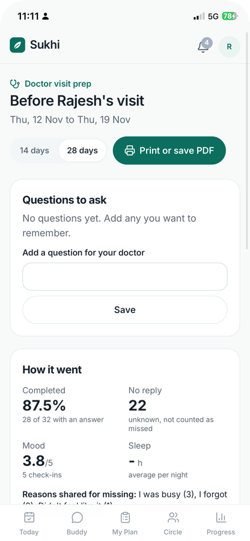

# Sukhi Care

**A care companion that helps people follow their care plan at home, and shows their family and doctor what really happened.**

People leave the clinic with a clear plan, then follow it alone for weeks. Doses and exercises get missed, and nobody knows until the next visit. Sukhi Care turns the plan into a daily routine, checks in kindly, helps people restart after a miss, and keeps the people who care in the loop. It works on the web and on WhatsApp, in English, Hindi and Marathi.

| | |
|---|---|
| **Live app** | [sukhi-60.vercel.app](https://sukhi-60.vercel.app) |
| **Demo video (3 min)** | [Watch on Google Drive](https://drive.google.com/file/d/1gR7_7XXUOw4ayDswuGMQXsUw62gxgAlP/view?usp=drive_link) |
| **Judge login** | `testuser@example.com` / `Sukhitestuser@2026` (test account, no real patient data) |
| **No-login walkthrough** | [sukhi-60.vercel.app/demo](https://sukhi-60.vercel.app/demo) |

<p>
  
  
  
  
  
</p>

> Sukhi Care is not a medical device. It does not diagnose, prescribe, change a dose or monitor emergencies. It helps people follow the plan their doctor already wrote.

## What it does

- **Prescription to plan.** A photo of the prescription is read by AI into plan items, and the patient confirms every item.
- **Reminders and one-tap check-ins.** Push and WhatsApp reminders with Done, Later and Skip. Replies can be a tap, a photo or a voice note.
- **Sukhi, the buddy.** Chat or voice in English, Hindi, Marathi or Hinglish. After a miss it asks what got in the way and suggests a smaller step or a better time. Plan changes always need the person's one-tap OK.
- **Photo proof that holds up.** Live camera only, reuse detection by image fingerprinting, a fresh-photo challenge, an AI description, and human review of doubtful cases within 12 hours. Doctors can require a photo on specific tasks.
- **Device readings.** A photo of a BP monitor or glucometer becomes a number the patient confirms.
- **Family: Caring for.** Up to 2 family members see today, the week and streaks, and can send a cheer. Read-only.
- **Doctor clinic.** Patient list, plan approval, photo-proof rules, weekly summary and rewards, on WhatsApp or the web.
- **Progress and visit prep.** 7 and 30-day views, the reasons behind misses, and a printable summary for the follow-up.
- **One account, many roles.** The same person can be a patient, a family member and a doctor, with a switcher between views.

## Pilot so far

Live with real users since 12 November 2026 (team accounts excluded): 23 people signed up, 18 built a plan, 375 check-ins, 4 prescriptions read into 44 plan items with 0 failures, median AI reply 5.8 s. The biggest lesson: when people reply they almost always say "done", but most reminders get no reply at all. The gap is silence, not refusal, which is why we built WhatsApp, voice notes and photo proof.

## How it's built

| Layer | Technology |
|---|---|
| Frontend | Next.js 16, React 19, Tailwind CSS 4, installable PWA with web push |
| Backend | Vercel functions and Supabase (Postgres, Auth, private Storage), both in Mumbai |
| AI | Anthropic Claude via the Vercel AI SDK: chat with tools, prescription and photo reading |
| Speech | ElevenLabs and Sarvam speech-to-text and text-to-speech |
| Messaging | Official Meta WhatsApp Cloud API with signed webhooks and an outbox with retries |
| Proof | sharp perceptual image fingerprinting, live-camera capture |
| Jobs | Postgres cron every minute: reminders, follow-ups, evidence checks, digests |
| Quality | TypeScript, zod, Vitest and Playwright, WhatsApp and proof simulators |

```
Browser / PWA ──► Next.js 16 on Vercel (Node runtime, Mumbai)
                   ├─ patient, family ("Caring for") and clinic views
                   ├─ /api/chat · /api/evidence · /api/plan/extract · /api/voice/*   (session-authenticated)
                   ├─ /api/whatsapp/webhook   (signature-verified; persist, enqueue, process)
                   └─ /api/worker/tick        (bearer secret; claims leased jobs)
Supabase ──► Postgres (row-level security on every patient table, SQL state functions, jobs outbox)
          ├─ Auth · private Storage buckets
          └─ pg_cron + pg_net ──► POST /api/worker/tick every minute
Providers ──► Anthropic · ElevenLabs / Sarvam · Meta WhatsApp Cloud API
```

**Safety by design**
- Identity always comes from the verified session or a verified WhatsApp number, never from model output. The model can act only through tools bound to that identity.
- Completion state and rewards change only through SQL functions.
- Self-reports and evidence are kept apart, and silence is recorded as "no reply", never as done or missed.
- Consent at sign-up, data hosted in Mumbai, proof photos deleted after 7 days.

## Run it with Docker (no keys needed)

```bash
git clone https://github.com/mehulsethia/sukhi-60.git
cd sukhi-60
docker compose up --build
```

Open [http://localhost:3000](http://localhost:3000). With no keys, Sukhi starts in **keyless mode**: the landing page and the guided demo at [/demo](http://localhost:3000/demo) work, and a notice explains that sign-in, AI, voice and WhatsApp need keys. To turn those on, copy `.env.example` to `.env`, fill in what you have (a Supabase project for sign-in, plus optional Anthropic, ElevenLabs or Sarvam and WhatsApp keys), and run the same command again. The full product is live at [sukhi-60.vercel.app](https://sukhi-60.vercel.app).

## Running it locally

| Script | Purpose |
|---|---|
| `pnpm dev` / `build` / `start` | Next.js |
| `pnpm db:start` / `db:reset` / `db:types` | Local Supabase, apply migrations, generate types |
| `pnpm check` | Typecheck, lint, tests and build |
| `pnpm test:unit` / `test:integration` / `test:e2e` | Vitest / Vitest against local Supabase / Playwright |
| `pnpm wa:simulate` / `proof:simulate` | End-to-end WhatsApp and photo-proof simulators |
| `pnpm check:config [--strict]` | Shows set, missing or invalid variables, never values |
| `pnpm worker:tick` / `jobs:health` | Manual worker run / job and outbox health |
| `pnpm seed:demo` | Fictional local demo account |

Start with [docs/OPERATOR_QUICKSTART.md](docs/OPERATOR_QUICKSTART.md): one path from a clean checkout to a demo, then AI and voice, then a real WhatsApp test. Copy [.env.example](.env.example) to `.env.local` for local work.

**More docs:** [SETUP.md](SETUP.md) · [WHATSAPP_SETUP.md](WHATSAPP_SETUP.md) · [USER_HANDOFF.md](USER_HANDOFF.md) · [ACCEPTANCE_REPORT.md](ACCEPTANCE_REPORT.md) · [BUILD_STATUS.md](BUILD_STATUS.md) · [LICENSE_NOTES.md](LICENSE_NOTES.md)

Built by Mehul Sethia (team Senseibles). All rights reserved.
